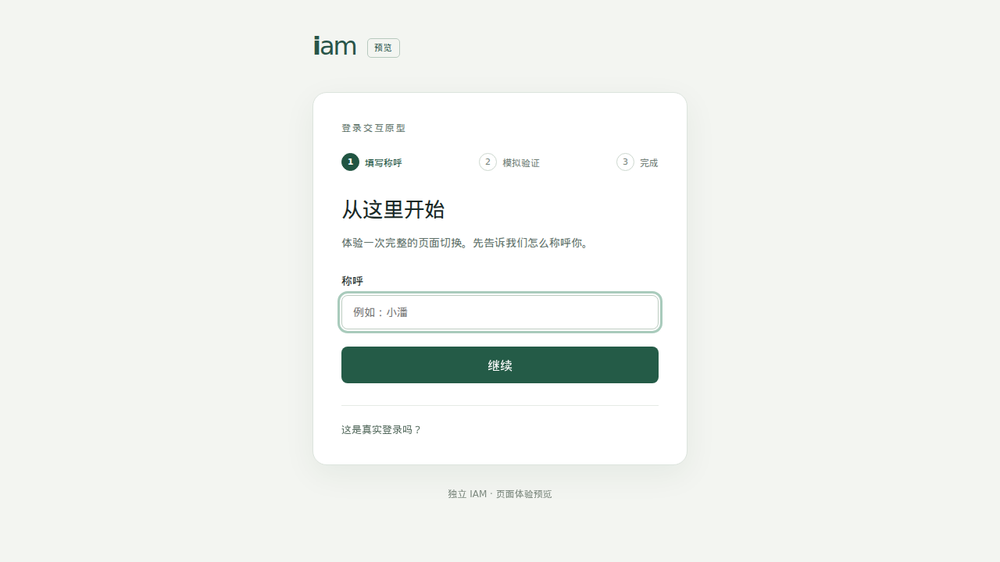

# 浏览器登录流程原型

参考 Keycloakify：Spring 返回 HTML 时内联当前页面上下文，React 用 `createRoot` 渲染，
表单原生 POST 到 Spring，后端按 session 中的步骤校验并返回 303 重定向。
每次导航重新挂载 React，带 hash 的 JS/CSS 可长期缓存。局部帮助展开不发请求。

这是浏览器交互实验，不是身份验证实现：没有 AD 查询、真实密码、TOTP、WebAuthn 或
Hydra accept；不会创建 Spring Security 登录身份。演示码 **123456** 仅用于切换页面，
不得作为 MFA 实现复用。默认关闭，显式设置 `iam.ui-preview.enabled=true` 才开放 `/preview`。
所有其他受保护入口仍需认证，Prometheus 权限保持不变。



## 本地体验

有 Node 24 和 JDK 25 时：

```sh
cd frontend
npm ci
npm run build
cd ..
./gradlew bootRun --args='--server.address=127.0.0.1 --server.port=18081 --iam.ui-preview.enabled=true'
```

访问 <http://127.0.0.1:18081/preview>。填写称呼，尝试错误演示码，再用 123456 完成。
后退链接、刷新、重新体验都走服务端流程。启用 DevTools 的 Network 面板观察 document
POST、303、GET；不要勾选 Disable cache，否则无法观察正常的静态资源缓存。

Docker 开发：

```sh
IAM_DOCKER_USE_SUDO=1 scripts/gradle-in-docker bootRun \
  --args='--server.address=127.0.0.1 --server.port=18081 --iam.ui-preview.enabled=true'
```

`gradle-in-docker` 先用固定 Node 镜像构建前端，再运行 GraalVM 容器。
Gradle 缓存默认 `$HOME/.cache/iam-login/gradle`，npm 缓存默认 `$HOME/.cache/iam-login/npm`；
可用 `IAM_GRADLE_CACHE` / `IAM_NPM_CACHE` 指定持久目录。Node 仅参与构建，部署无 Node 服务。
直接调用 Gradle 时先构建前端；缺少 `frontend/dist/index.html` 会明确失败。
前端 watch 可用 `npm run watch`，修改后仍需让后端重新复制资源并重启；本轮不实现 HMR 桥接。

## 验证

```sh
IAM_DOCKER_USE_SUDO=1 scripts/gradle-in-docker test testAot nativeTest nativeCompile
python3 scripts/native-smoke.py
build/native/nativeCompile/iam-login --server.address=127.0.0.1 --server.port=18081 \
  --iam.ui-preview.enabled=true
# 另一个终端，应用保持运行
cd frontend
npm ci
npx playwright install chromium
npm run test:browser
```

浏览器测试覆盖原生页面导航、错误重试、局部交互零请求、无 fetch/XHR、静态 JS 缓存、
移动端布局、脚本结束标记转义，以及完成预览仍不能访问受保护应用。
额外计时使用 Chromium 模拟 60ms 网络延迟、1.5Mbps 下载和四倍 CPU slowdown，
用于比较首屏和缓存后的页面切换，不代表真实 LAN、Tailscale 或手机性能。

## 实现边界

- 页面壳在 `frontend/index.html`，Vite 构建后作为私有 classpath 资源 `ui/index.html` 打包，
  不提供静态 index 入口；控制器仅替换一个固定 JSON 数据位置。
- Java 使用 JSON 序列化后转义 `<`、`>`、`&` 和 Unicode 行分隔符，避免 `</script>` 逃逸；
  React 按文本输出动态内容，不通过 HTML 字符串插入用户名。
- session 持有演示步骤。表单带 Spring Security CSRF token，缺失被拒绝；
  非当前步骤的提交拒绝，未知/过期 session 的后续页面回到初始步骤。
- 页面与重定向 `no-store`，静态 hash 资源 public/immutable。CSP 不允许内联可执行脚本。
- 单 session 仅有一个演示流程，多标签页会共享步骤。正式认证需要独立事务、过期策略、
  主体与因素绑定；本原型不提供这些保证。
- 当前采取整页切换，不提前实现 fetch 优化。后续根据测量选择需要局部更新的步骤。
- 首屏依赖 JavaScript，没有 React SSR、Flight、客户端路由、FreeMarker 或模板引擎。
  关闭 JavaScript 时显示明确提示，不宣称无 JS 可用。

来源：[Keycloakify 入口](https://github.com/keycloakify/keycloakify-starter/blob/main/src/main.tsx)、
[登录表单](https://github.com/keycloakify/keycloakify/blob/main/src/login/pages/Login.tsx)、
[Vite 构建](https://vite.dev/guide/build)。

## 2026-09-25 本地验证结果

本轮应用代码为 `dcf634d`，随后修正 smoke 对 HTML 入口的 Accept 请求头。
使用固定 GraalVM Java 25.0.2 镜像，构建限制 4 CPU / 8 GiB；原生应用采用默认 O2。

| 检查 | 结果 |
|---|---|
| 前端 TypeScript / Vite、bootJar | 通过 |
| JVM test / testAot / nativeTest | 各 6 项，0 失败、0 跳过 |
| Native 应用 smoke | liveness UP；匿名应用及指标 401；认证指标 200；健康请求计数增加 3 |
| 默认关闭 / 显式开启预览 | HTML 请求分别 404 / 200，在同一 Native 构建上实测 |
| Native 上的 Chromium 测试 | 3 项通过，包含整页原生 POST、无 fetch/XHR、缓存、转义与移动端 |
| ELF 文件大小 | 126,291,016 bytes，约 120.44 MiB，不是容器镜像大小 |
| 启动到 liveness 可响应 | 单次 0.351 秒 |
| smoke 请求后 RSS | 148,996 KiB，约 145.50 MiB |
| 模拟限速下的首屏 | 从导航开始到 React 提交 DOM：1,702 ms |
| 模拟限速下的缓存后切换 | Playwright 点击开始到下一页标题可见：560 ms |

浏览器计时条件为 60ms 网络延迟、1.5Mbps 下载、0.75Mbps 上传及四倍 CPU slowdown。
这是单次、本机、模拟网络测量，不是生产 SLA，两个计时区间也不同；不据此声称 Native
比 JVM 快多少。原型没有启用 HTTP 压缩，首屏实际下载约 223KB JS；构建日志中的约 70KB
是 gzip 估算，不是本轮实际传输大小。后续页面的 JS `transferSize=0`，确认命中浏览器缓存。

本轮没有新增反射补丁。Native 测试日志以及 smoke 的启动、请求、关闭阶段未发现 Native
反射或资源注册错误。生成目录中的配套 `.so` 文件应随 Native 产物保留；这里不承诺单文件
静态链接交付。AD、真实 MFA、Hydra 和人类验收不在这些结果范围内。
